<p align="center">
  
</p>

<h1 align="center">Varu</h1>

<p align="center">
  <b>Kaardid, varjumiskohad ja raamatukogu, mis töötavad ka siis, kui internet ei tööta.</b><br>
  Sinu arvutis, telefonis ja sahtlis ootaval USB-mälupulgal.
</p>

<p align="center">
  🇪🇪 <b>Eesti keeles</b> &nbsp;·&nbsp; 🇬🇧 <a href="README.md">English</a>
</p>

<p align="center">
  <a href="https://github.com/renereose/varu/releases/latest"><b>⬇&nbsp; Laadi Varu alla</b></a>
  &nbsp;·&nbsp; <a href="#-tee-perele-varu-mälupulk">Tee mälupulk</a>
  &nbsp;·&nbsp; <a href="#-paigalda-android-telefoni">Android-telefon</a>
  &nbsp;·&nbsp; <a href="#-küsimused-ja-mured">Abi</a>
</p>

<p align="center">
  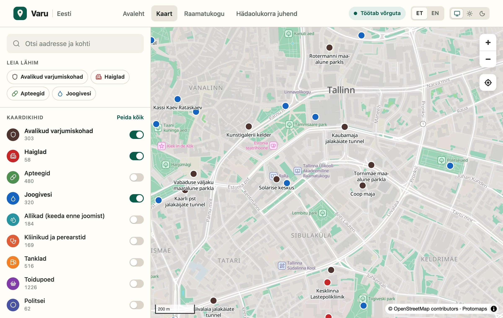
</p>

Kui kaob vool või mobiilside, lakkavad töötamast ka harjumuspärased äpid:
veebikaardid, otsing, uudised. **Varu** hoiab kõige vajalikuma sinu enda
seadmetes, nii et see töötab täiesti ilma internetita:

- 🗺️ **Eesti kaart**: kodu ümber tänavate täpsusega, ülejäänud riik reisimiseks.
- 🛡️ **Avalikud varjumiskohad**: kõik Päästeameti 303 varjumiskohta, lisaks haiglad, apteegid, joogivesi, tanklad, toidupoed, politsei ja muu.
- 🔎 **Otsing**: iga Eesti linn, küla, tänav ja majaaadress.
- 🧭 **Teejuhised**: jalgsi või autoga, ka „vii mind lähimasse varjumiskohta, mööda teid”.
- 📍 **Juhised teel** telefonis: järgmine pööre, tänava nimi ja kui palju on jäänud.
- 📚 **Raamatukogu**: eestikeelne Vikipeedia, meditsiinientsüklopeedia ja katastroofijärgse toimetuleku käsiraamatud, kõik otsitavad.

Varu on tasuta ja avatud lähtekoodiga. See ei jälgi sind, sel pole reklaame
ega kasutajakontosid ning internetti on vaja vaid üks kord, et kõik alla laadida.

<table>
  <tr>
    <td align="center" width="33%">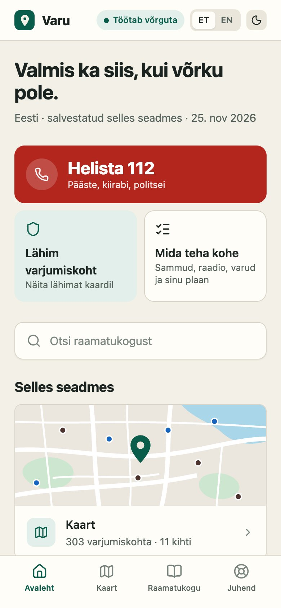<br><sub>Avaleht</sub></td>
    <td align="center" width="33%">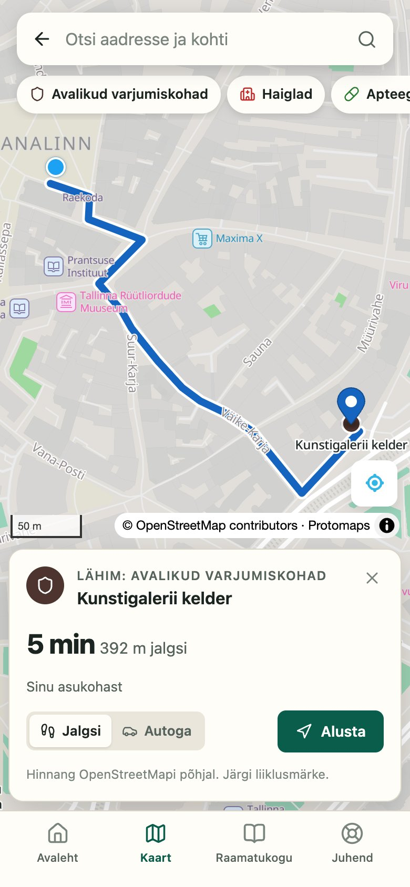<br><sub>Lähim varjumiskoht, mööda teid</sub></td>
    <td align="center" width="33%">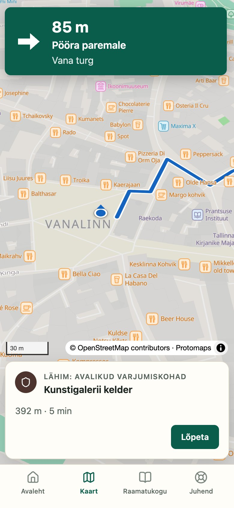<br><sub>Juhised teel</sub></td>
  </tr>
</table>

---

## Sisukord

1. [Mida on vaja](#-mida-on-vaja)
2. [Paigalda arvutisse](#-paigalda-arvutisse) (Mac, Windows, Linux)
3. [Tee perele Varu mälupulk](#-tee-perele-varu-mälupulk)
4. [Paigalda Android-telefoni](#-paigalda-android-telefoni)
5. [Varu kasutamine](#-varu-kasutamine): kaart, varjumiskohad, teejuhised, raamatukogu
6. [Mälupulga avamine teises arvutis](#-mälupulga-avamine-teises-arvutis)
7. [Varu uuendamine](#-varu-uuendamine)
8. [Raspberry Pi](#-raspberry-pi)
9. [Hädaolukorras](#-hädaolukorras)
10. [Küsimused ja mured](#-küsimused-ja-mured)
11. [Kust andmed pärinevad](#-kust-andmed-pärinevad)

---

## ✅ Mida on vaja

- **Arvuti** (Mac, Windows või Linux) või **Android-telefon** (Android 7 või uuem).
- **Internetiühendus üks kord**, et Varu alla laadida. Hiljem pole seda vaja.
- **Mälupulga jaoks:** sobib **16 GB** pulk. Kõik mahub ka 8 GB pulgale, kuid raamatu uuendamisel on korraks vaja ruumi nii vanale kui ka uuele koopiale.
- **Aega:** allalaadimine võtab mõnest minutist (ainult kaart) kuni tunni või rohkemani (kõik raamatud aeglase ühendusega).

| Mida valid | Umbes nii palju laaditakse alla |
|---|---|
| Eesti kaart ja kõik kohad | 0,4 GB |
| Varu Windowsile, Macile ja Linuxile (läheb igale pulgale) | 0,5 GB |
| Vikipeedia | 3,1 GB |
| WikiMed, meditsiinientsüklopeedia (inglise keeles) | 2,0 GB |
| Post Disaster Resource Library (inglise keeles) | 0,6 GB |

> 💡 **iPhone?** iPhone'i äppi veel pole. iPhone'iga saab Varut kasutada
> WiFi kaudu, kui arvuti või Android-telefon [seda jagab](#jagamine-teiste-telefonidega),
> või [koduse WiFi kaudu Raspberry Pi pealt](#-raspberry-pi).

---

## 💻 Paigalda arvutisse

Laadi oma arvuti jaoks sobiv fail
**[viimasest väljalaskest](https://github.com/renereose/varu/releases/latest)**:

| Sinu arvuti | Laadi alla |
|---|---|
| 🍎 **Mac** | [`Varu-macOS.dmg`](https://github.com/renereose/varu/releases/latest/download/Varu-macOS.dmg) |
| 🪟 **Windows** | [`Varu-Setup-Windows.exe`](https://github.com/renereose/varu/releases/latest/download/Varu-Setup-Windows.exe) |
| 🐧 **Linux** | [`Varu-Linux-x86_64.AppImage`](https://github.com/renereose/varu/releases/latest/download/Varu-Linux-x86_64.AppImage) või `.deb`-fail [väljalaske lehelt](https://github.com/renereose/varu/releases/latest) |

<details>
<summary><b>🍎 Mac samm-sammult</b></summary>

1. Ava allalaaditud **Varu-macOS.dmg**. Avaneb aken, kus on Varu ja kaust Applications.
2. **Lohista Varu kausta Applications.**
3. Ava kaust **Applications** ja tee topeltklõps **Varu** peal.
4. Esimesel korral võib Mac öelda *„Apple could not verify Varu…”*. Põhjus on
   selles, et Varu on tasuta projekt, mis pole Apple'i juures registreeritud.
   Et see ikkagi avada:
   - Klõpsa **Done** (Valmis).
   - Ava **System Settings → Privacy & Security** (Süsteemiseaded → Privaatsus ja turvalisus) ja keri alla.
   - Rea *„Varu was blocked…”* juures klõpsa **Open Anyway** (Ava ikkagi) ja sisesta parool.
   - Edaspidi avaneb Varu tavapäraselt.
5. Varu käivitab paigaldusviisardi: jätka peatükiga
   [Tee mälupulk](#-tee-perele-varu-mälupulk). Viisard on sama, olenemata
   sellest, kas valid mälupulga või selle arvuti.

</details>

<details>
<summary><b>🪟 Windows samm-sammult</b></summary>

1. Ava allalaaditud **Varu-Setup-Windows.exe**.
2. Kui Windows ütleb *„Windows protected your PC”* (Windows kaitses teie
   arvutit), klõpsa **More info** (Rohkem teavet) ja siis **Run anyway**
   (Käivita ikkagi). Varu on tasuta projekt, millel pole Microsofti tasulist sertifikaati.
3. Varu paigaldab end ise ja avab paigaldusviisardi: jätka peatükiga
   [Tee mälupulk](#-tee-perele-varu-mälupulk).

Ei taha midagi paigaldada? Väljalaske lehel olev `Varu-Windows.exe` töötab ka niisama.

</details>

<details>
<summary><b>🐧 Linux samm-sammult</b></summary>

- **AppImage** (iga distributsioon): paremklõps failil → **Properties** →
  **Permissions** → märgi **Allow executing file as program**, siis tee topeltklõps.
  Terminalis: `chmod +x Varu-Linux-x86_64.AppImage && ./Varu-Linux-x86_64.AppImage`
- **Debian, Ubuntu, Mint**: laadi alla `varu_<versioon>_amd64.deb` ja ava see
  või käivita `sudo apt install ./varu_*_amd64.deb`. Varu ilmub rakenduste menüüsse.
- **Raspberry Pi 4 või 5** töölaua jaoks kasuta `arm64`-faile.

</details>

---

## 🔑 Tee perele Varu mälupulk

Varu mälupulk töötab **igas** Windowsi, Maci ja Linuxi arvutis ilma midagi
paigaldamata. Hoia üks sahtlis, teine autos või kingi üks vanematele.

1. **Ühenda mälupulk.** Kõik sellel olev jääb alles, kui viisard ei pea pulka
   ümber vormindama (selle kohta küsib ta alati enne luba).
2. **Ava Varu.** Esimesel korral käivitub viisard ise. Hiljem leiad selle
   menüüst **Mine → Paigalda või uuenda…**.
3. Läbi neli sammu:

<table>
  <tr>
    <td width="50%" valign="top">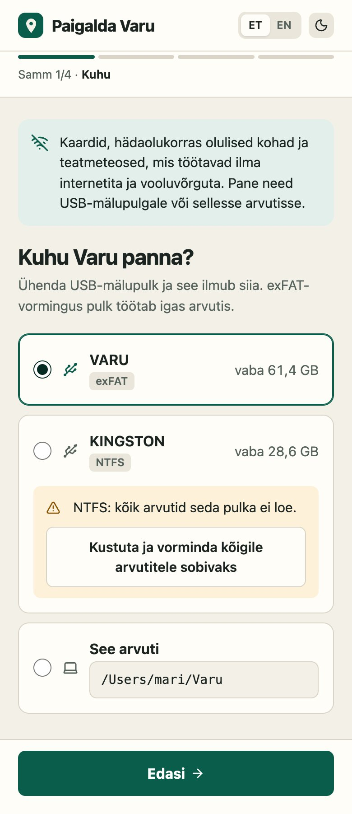<br><b>1. Kuhu Varu panna.</b> Vali oma mälupulk. Kui see pole vormingus, mida loeb iga arvuti, pakub Varu selle kustutamist ja vormindamist. Enne küsib ta alati luba, sest kustutamine eemaldab pulgalt kõik.</td>
    <td width="50%" valign="top">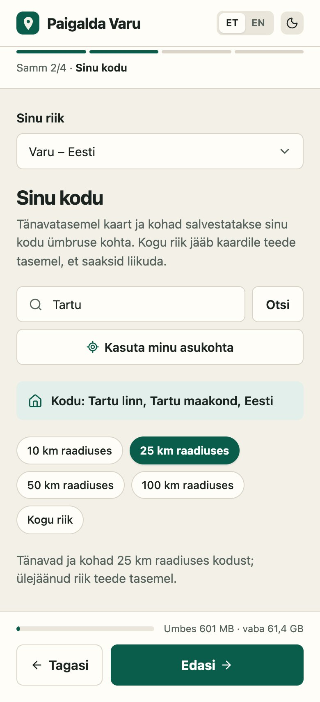<br><b>2. Sinu kodu.</b> Kirjuta oma linna või küla nimi ja vajuta <b>Otsi</b>. Seejärel vali, kui kaugele kodust soovid tänavate täpsust: 10, 25, 50 või 100 km või kogu riik.</td>
  </tr>
  <tr>
    <td valign="top">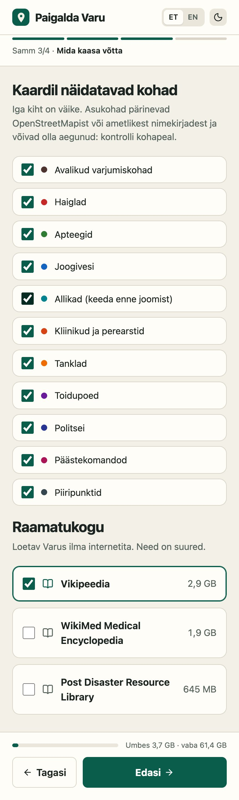<br><b>3. Kohad ja raamatud.</b> Kõik kohad on valitud, sest need on väikesed. Märgi raamatukogu raamatud, mida soovid; iga raamat on suur.</td>
    <td valign="top">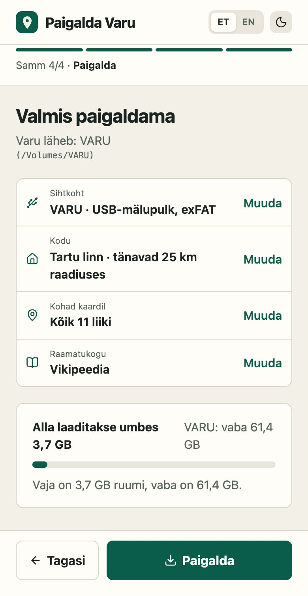<br><b>4. Ülevaade.</b> Kontrolli allalaadimise suurust ja vaba ruumi ning vajuta <b>Paigalda</b>.</td>
  </tr>
</table>

4. **Oota, kuni ilmub „Varu on valmis”.** Kui ühendus katkeb, ava Varu
   uuesti: see jätkab sealt, kus pooleli jäi.
5. **Väljuta pulk** enne eemaldamist: Macis Finderi ⏏ nupuga, Windowsis
   *Riistvara ohutu eemaldamine*.

Pulka avades näed ainult nelja faili: igale süsteemile oma Varu ja juhend
README. Kaardid ja raamatud on samuti pulgal, aga peidetud, et keegi neid
kogemata ära ei kustutaks.

---

## 📱 Paigalda Android-telefoni

1. Ava see leht telefonis ja laadi alla
   **[Varu.apk](https://github.com/renereose/varu/releases/latest/download/Varu.apk)**.
2. Ava allalaaditud fail. Android küsib luba brauserist äppe paigaldada:
   puuduta **Seaded**, lülita sisse **Luba sellest allikast**, mine tagasi ja puuduta **Installi**.
3. Kui *Play Protect* hoiatab tundmatu äpi eest, puuduta **Rohkem üksikasju →
   Installi ikkagi**. Varu ei ole veel Play poes.
4. Ava **Varu**. Käivitub sama paigaldusviisard. Vali **See telefon** (või
   mälukaart, kui telefonis see on), oma kodu ja mida soovid, siis **Paigalda**.
5. Hoia allalaadimise ajal telefon WiFi-võrgus. Varu küsib luba teavitusi näidata:
   luba see, et edenemist seal näha. Vahepeal võid telefoni lukustada või teisi
   rakendusi kasutada, allalaadimine jätkub. Pärast seda töötab Varu ka lennukirežiimis.

Ülal olevas menüüs **⋮** on **Kaart** ja **Allalaadimised**, mis avab viisardi uuesti.

---

## 🧭 Varu kasutamine

### Avaleht

Varu avaneb avalehega. Üleval on kolm suurt nuppu: **📞 112**, **Lähim
varjumiskoht** (kaart koos teekonnaga lähimasse avalikku varjumiskohta) ja
**Hädaolukorras**. Nende all on **Kaardid**, **Raamatukogu** ja **Dokumendid**
ning näha on, millal andmed koostati, et teaksid, kui värsked need on.
Otsingukast otsib kõigist raamatukogu raamatutest.

### Hädaolukorras

Leheküljel **Hädaolukorras** on kolm osa:

- **Kui juhtub**: lühikesed sammud elektri-, vee-, kütte- ja sidekatkestuse,
  sireeni ja ohuteate, varjumise, evakueerimise, tulekahju, vingugaasi, tormi,
  üleujutuse, metsas eksimise ja 112 helistamise korral. Igalt kaardilt saab
  lähima koha kaardile ja raamatukogu artiklitesse ning iga kaart nimetab
  ametliku allika, millel see põhineb (kriis.ee, Päästeamet, Siseministeerium,
  Terviseamet ja Häirekeskus).
- **Kodune varu**: kontrollnimekiri, et nädal aega ise hakkama saada.
  Linnukesed jäävad sellesse seadmesse.
- **Minu plaan**: kontaktid, kokkusaamiskohad, kus on dokumendid ja ravimid.
  Jääb ainult sellesse seadmesse: vajuta **Prindi** ja hoia ka paberkoopiat.

### Kaart

<p align="center"></p>

- **Kihid** (üleval vasakul) näitab, mida kaardil kuvada saab: varjumiskohad,
  haiglad, joogivesi ja muu. Märgi kast, et kiht nähtavale tuua, ja puuduta
  täppi, et näha koha nime ja aadressi.
- **◎ nupp** (üleval paremal) näitab, kus sa oled. Telefon kasutab GPS-i, mis
  töötab ilma internetita. Enamikus arvutites GPS-i pole.
- **Lähim**, iga kihi kõrval, leiab lähima koha **mööda teid**, mitte
  linnulennult, nii et jõgi või meri ei saada sind pikka ringi tegema.

### Otsing

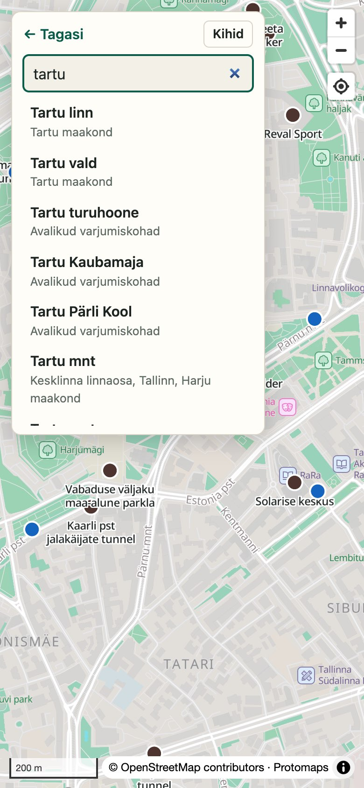

Kirjuta kihtide kohal olevasse kasti: linn või küla (**Otepää**), tänav,
majaaadress (**Rüütli 12 Pärnu**) või koht kaardikihtidelt, näiteks haigla või
varjumiskoht (**Tartu Ülikooli Kliinikum**).

- Tähed õ, ä, ö ja ü võib kirjutada ilma täppideta: **otepaa** leiab Otepää.
- Puuduta tulemust ja kaart liigub sinna. Selle nööpnõela juures on **Tee siia** ja **Alusta siit**.
- Mälupulgal on kõik Eesti aadressid, ka väljaspool sinu kodukanti.

<br clear="right">

### Teejuhised

- **Telefonis:** vajuta kaardil kohale ja hoia sõrme all. **Arvutis:** tee sellel paremklõps.
  Seejärel vali **Tee siia** või **Alusta siit**, et alustada mujalt.
- Vali **Jalgsi** või **Autoga**. Paneel näitab vahemaad ja aega.
- **Alusta** käivitab **juhised teel**: üleval näed järgmist pööret ja
  tänava nime, kaart pöörab koos sinuga ning valesti keerates leiab Varu uue
  tee. **Lõpeta** lõpetab.

<table>
  <tr>
    <td align="center" width="50%"><br><sub><b>Lähim</b> varjumiskoht: 430 m, jalgsi 5 minutit</sub></td>
    <td align="center" width="50%"><br><sub><b>Alusta</b>: „35 m, pööra vasakule, Kuninga”</sub></td>
  </tr>
</table>

> ⚠️ Teejuhised on OpenStreetMapi põhjal tehtud hinnang. Varu ei tea suletud
> teedest ega liiklusest. Järgi alati liiklusmärke ja ametiasutuste juhiseid.

### Raamatukogu

<table>
  <tr>
    <td align="center" width="50%">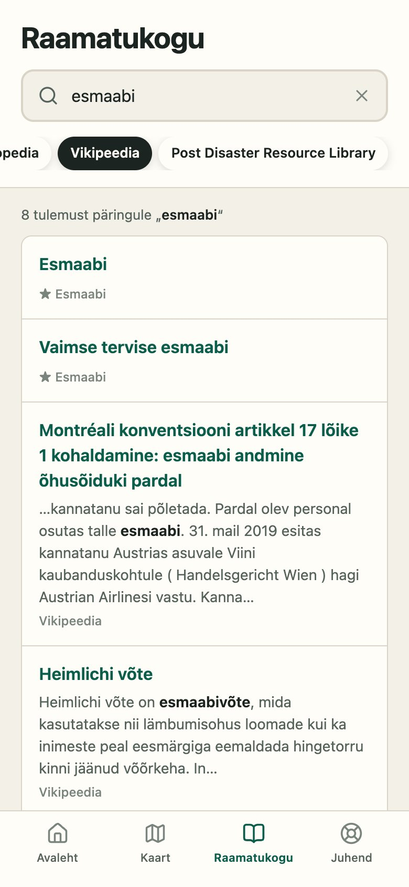<br><sub>Vikipeedia avaneb otsinguga</sub></td>
    <td align="center" width="50%">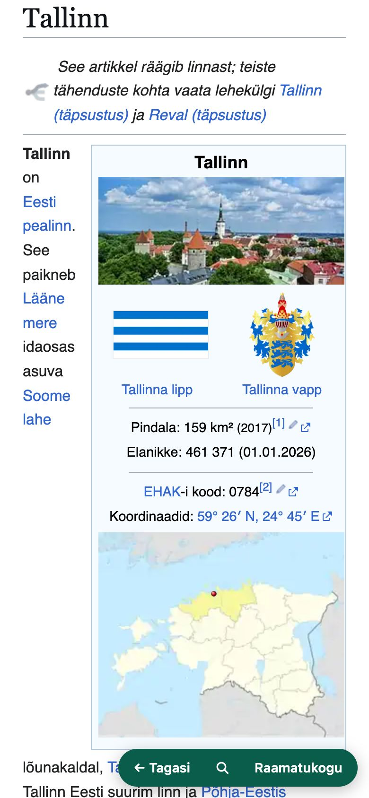<br><sub>Vikipeedia lugemine: <b>← Tagasi</b>, <b>🔍 Otsi</b>, <b>Raamatukogu</b></sub></td>
  </tr>
</table>

- Raamat avaneb oma otsinguleheküljega. Kirjuta otsingukasti: esmalt tulevad
  sobivad **pealkirjad**, siis **artiklid, milles su sõnad esinevad**, ja sõnad
  on esile tõstetud. Raamatu esileht on kasti all.
- Raamatu sees on all rohelisel ribal **Tagasi**, **🔍 Otsi** (tagasi selle
  raamatu otsingusse) ja **Raamatukogu**.
- **Raamatukogu** leheküljel saab otsida kõigist raamatutest korraga.
- **Ellujäämine ja tee-ise** raamatukogu leheküljel koondab valitud artiklid
  teemade kaupa: esmaabi, vesi, toit, soojus ja tuli, peavari, elekter ja
  valgus, side, hügieen, tööriistad ja parandamine, orienteerumine, ohud ning
  elanikkonnakaitse. Otsides tulevad sobivad neist esimesena, tähisega ★.
- Pikemad sõnad leiavad ka teisi vorme: *tallinn* leiab *Tallinnas*.

### Jagamine teiste telefonidega

Arvuti või Android-telefon, milles Varu töötab, saab seda jagada kõigile
samas WiFi-võrgus olevatele telefonidele, tahvelarvutitele ja sülearvutitele,
ka iPhone'idele. Neil pole vaja internetti ega äppi.

1. Ava avalehe allosas **Jaga teiste seadmetega** ja vajuta **Lülita jagamine
   sisse**. Arvuti võib küsida, kas Varu tohib võrguühendusi vastu võtta:
   luba see.
2. Ühenda teine telefon samasse WiFi-võrku (või selle arvuti või telefoni
   kuumkohta), skanni kood kaameraga või sisesta näidatud aadress.
3. **Lõpeta jagamine** või Varu sulgemine lõpetab jagamise.

Teistes seadmetes töötavad kaart, kohad, **Lähim**, teejuhised ja
raamatukogu. **Näita minu asukohta** ja **juhised teel** ei tööta: brauserid
jagavad asukohta ainult sama seadme äppidega või turvaliste (https)
lehtedega. Vajuta kaardil ja hoia sõrme all → **Alusta siit**, et öelda, kus
oled.

---

## 🔌 Mälupulga avamine teises arvutis

| Arvuti | Mida teha |
|---|---|
| 🪟 Windows | Ava pulk ja tee topeltklõps failil **Varu-Windows.exe**. Kui ilmub *„Windows protected your PC”*: **More info → Run anyway**. |
| 🍎 Mac | Ava pulk, tee topeltklõps failil **Varu-macOS.dmg** ja avanenud aknas **Varu** peal. Paigaldada pole vaja. |
| 🐧 Linux | Tee topeltklõps failil **Varu-Linux-x86_64.AppImage**. Ubuntu ja Fedora võivad pakkuda Varu käivitamist kohe, kui pulk ühendatakse. |

Varu leiab pulgalt oma kaardid ja raamatud ise. Arvutisse ei paigaldata midagi
ega jäeta maha.

---

## 🔄 Varu uuendamine

Uued versioonid toovad uusi võimalusi, värskeid kaarte ja uuemaid raamatuid. Uuendamiseks:

1. Laadi alla ja paigalda äpi uus versioon, nagu eespool.
2. Ava Varu. Kui kaardid ja andmed on äpist vanemad, küsib Varu
   **„Uuenda kaarte ja andmeid?”** Puuduta **Uuenda** või **Hiljem**: Varu
   töötab vahepeal edasi, ka ilma internetita.
3. Viisard avaneb viimasel sammul sinu varasemate valikutega. Vajuta **Paigalda**.
   Muutumata faile uuesti alla ei laadita. Kui raamatust on uuem väljaanne,
   kustutatakse vana alles siis, kui uus on täielikult alla laaditud, nii et vanad
   koopiad ei võta ruumi.

Mälupulga uuendamiseks ühenda see ja vali **Mine → Paigalda või uuenda…**.
Telefonis kasuta **⋮ → Allalaadimised**.

> 💡 Uuenda pulka iga paari kuu tagant: poed suletakse, teed muutuvad ja
> lisandub uusi varjumiskohti.

---

## 🍓 Raspberry Pi

### Varu-kast koduse WiFi jaoks

Väike Raspberry Pi võib Varut pidevalt käigus hoida ja jagada seda kõigile
koduse WiFi telefonidele, tablettidele ja sülearvutitele, ka iPhone'idele.
Akupangaga töötab see ka voolukatkestuse ajal.

> 🧪 See töötab failidega, mis Varuga juba kaasas on, kuid päris Raspberry
> Pi peal pole seda veel proovitud. Kui proovid, anna palun teada, kuidas läks.

**Vaja läheb:**
- **Raspberry Pi Zero 2 W**, 3, 4 või 5. Algne Pi Zero ja Zero W on Varu
  jaoks liiga vanad.
- **microSD-kaarti** (16 GB+), Pi toiteplokki või akupanka.
- Viisardiga tehtud **Varu mälupulka** ja Zero 2 W jaoks **micro-USB → USB-A
  adapterit** (OTG).

**Seadistamine:**

1. Paigalda arvutisse **[Raspberry Pi Imager](https://www.raspberrypi.com/software/)**.
   Vali oma Pi, siis **Raspberry Pi OS Lite (64-bit)** ja oma kaart. Kui
   küsitakse, **muuda seadeid**: vali kasutajanimi ja parool, sisesta oma
   WiFi andmed ja lülita sisse **SSH**.
2. Pane kaart Pi sisse, ühenda Varu pulk (Zero 2 W puhul pessa **USB**, mitte
   PWR) ja ühenda toide. Oota kaks minutit.
3. Ava arvutis **Terminal** (Mac, Linux) või **PowerShell** (Windows) ja
   ühendu oma valitud nime ja kasutajaga:
   ```sh
   ssh mari@raspberrypi.local
   ```
4. Seadista pulk igal käivitusel samasse kohta:
   ```sh
   sudo mkdir -p /mnt/varu
   echo "LABEL=VARU /mnt/varu exfat defaults,nofail,uid=$(id -u),gid=$(id -g) 0 0" | sudo tee -a /etc/fstab
   sudo systemctl daemon-reload && sudo mount -a && ls /mnt/varu
   ```
   Peaksid nägema faili `Varu-Windows.exe` ja teisi. Kui ei, käivita
   `lsblk -f` ja kasuta `VARU` asemel oma pulga nime (Varu nimetab enda
   vormindatud pulgad nimega `VARU`).
5. Käivita Varu iga kord, kui Pi käivitub:
   ```sh
   sudo tee /etc/systemd/system/varu.service >/dev/null <<EOF
   [Unit]
   Description=Varu
   RequiresMountsFor=/mnt/varu
   Wants=network-online.target
   After=network-online.target
   [Service]
   User=$USER
   ExecStart=/mnt/varu/bin/linux-arm64/varu -root /mnt/varu -lan -no-browser
   Restart=on-failure
   [Install]
   WantedBy=multi-user.target
   EOF
   sudo systemctl enable --now varu
   journalctl -u varu -n 20
   ```
   Viimane käsk näitab aadressi, näiteks `Network: http://192.168.1.23:8480/`.
6. **Ava see aadress mis tahes samas WiFi-võrgus olevas telefonis või
   sülearvutis.** Lisa see avaekraanile, et see kergesti uuesti üles leida.

**Ruuterit pole?** Pi saab teha oma WiFi-võrgu nimega *Varu*:
```sh
sudo nmcli device wifi hotspot ssid Varu password "vali-parool"
sudo nmcli connection modify Hotspot connection.autoconnect yes
```
Ühendu võrguga *Varu* ja ava `http://10.42.0.1:8480/`.

> ℹ️ WiFi kaudu töötavad kaart, kohad, **Lähim**, teejuhised ja raamatukogu.
> **Näita minu asukohta** ja **juhised teel** ei tööta: brauserid jagavad
> asukohta ainult sama seadme äppidega või turvaliste (https) lehtedega.
> Vajuta kaardil ja hoia sõrme all → **Alusta siit**, et öelda, kus oled.

**Ekraani, klaviatuuri ja hiirega Pi 4 või 5:** paigalda töölauaga
*Raspberry Pi OS (64-bit)*, siis väljalaske lehelt Linuxi `arm64` Varu
(`varu_<versioon>_arm64.deb`) ja kasuta seda nagu igas arvutis.

### Tulekul: taskuseade e-tindi ekraani ja GPS-iga

Kavandame taskusuurust Varut: **Raspberry Pi Zero 2 W** koos **e-tindi
ekraani**, **GPS-mooduli**, mõne **nupu** ja **akuga**. See näitab kaarti,
sinu asukohta ning lähimat joogivett või varjumiskohta päevade kaupa ühe
laadimisega ja ilma telefonita.

> 🚧 **Seade veel ei tööta.** Tarkvara esimene osa on kirjutatud: see
> joonistab Varu andmetest e-tindi ekraani kaardivaateid, praegu ainult
> piltidena arvutis (vt allpool). Päris e-tindi ekraanile need veel ei jõua
> ning GPS-i ja nuppe miski ei loe. Plaani saad jälgida failis
> [docs/plans/pi-eink-phase1.md](docs/plans/pi-eink-phase1.md).

Nii võiks ekraan välja näha, joonistatud Eesti kaardist (400×300 pikslit,
tegelikus suuruses umbes 85 mm lai):

| Rõuge, must-valge | Tallinna vanalinn, 4 halli tooni | Tartu ja ümbrus, must-valge |
|---|---|---|
| 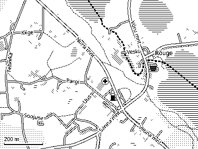 | 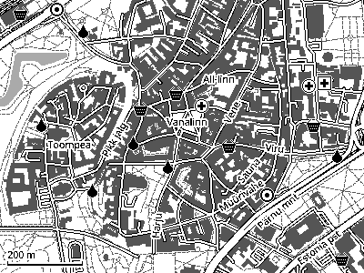 | 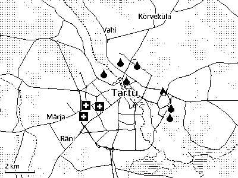 |

Arendajad saavad ise pilte joonistada käsuga `make mockups DRIVE=/Volumes/VARU`
(vt [docs/DEVELOPMENT.md](docs/DEVELOPMENT.md)).

Kui tahad riistvara juba koguda ja proovida, siis selle peale me plaanime:

| Osa | Plaanis | Märkused |
|---|---|---|
| Arvuti | Raspberry Pi Zero 2 W | joodetud 40-kontaktilise liidesega |
| Ekraan | 4,2" e-paberi HAT (400×300), nt Waveshare | kaalumisel ka 5,83" (648×480) |
| GPS | u-blox NEO-6M või NEO-M8N moodul | sobib iga u-blox, mis saadab NMEA-d kiirusel 9600; sobib ka USB u-blox |
| Toide | LiPo aku koos laadijaga, nt PiSugar | |
| Nupud | 5–6 nuppu | ühendamise juhend tuleb koos tarkvaraga |

<details>
<summary><b>u-blox GPS-i ühendamine ja kontrollimine</b></summary>

1. **Juhtmed** (kontaktide numbrid on Pi füüsilised kontaktid). Enamik
   u-blox moodulite plaate töötab 3,3 V pealt; kontrolli oma moodulit.

   | GPS-moodul | Raspberry Pi |
   |---|---|
   | VCC | kontakt 1 (3,3 V) |
   | GND | kontakt 6 (GND) |
   | TX | kontakt 10 (GPIO 15, RXD) |
   | RX | kontakt 8 (GPIO 14, TXD) |

   Kui e-paberi HAT on liidesel, kasuta läbivat liidest või joota juhtmed Pi
   alt. HAT kasutab SPI-d ja veel mõnda kontakti, kuid mitte kontakte 8 ja 10.
2. Lülita jadaport sisse: `sudo raspi-config` → **Interface Options** →
   **Serial Port**: sisselogimiskest **No**, jadapordi riistvara **Yes**.
   Ekraani jaoks lülita sisse ka **SPI**. Taaskäivita.
3. Kontrolli, et GPS räägib:
   ```sh
   stty -F /dev/serial0 9600 && cat /dev/serial0
   ```
   Ekraanil peaksid jooksma read, mis algavad `$GP` või `$GN`. Mine õue:
   esimene asukoht võib võtta mõne minuti ja selle leidmise järel ilmuvad
   asukohaga read. Lõpetamiseks vajuta Ctrl+C.
4. USB u-blox ilmub hoopis kui `/dev/ttyACM0`: `cat /dev/ttyACM0`.

</details>

---

## 🆘 Hädaolukorras

- **Ohu korral helista 112.** Varu on varu, mitte päästeteenistus.
- Telefon leiab oma asukoha **GPS-iga ilma interneti ja mobiilsideta**.
  Lae telefon ja akupank aegsasti täis ning hoia telefon energiasäästurežiimis.
- Varu andmed on **hetkeseis**: avalehel on näha nende kuupäev. Kohad
  võivad olla suletud või kolinud. Kontrolli kohapeal.
- **Järgi ametiasutuste juhiseid.** Kui need on kättesaadavad, on nende
  juhised esikohal: raadios (ERR) ja interneti olemasolul aadressil
  [kriis.ee](https://www.kriis.ee).
- Hoia mälupulka kohas, mida kogu pere teab, ja näita neile, kuidas seda
  avada ([vaata eespool](#-mälupulga-avamine-teises-arvutis)).

---

## ❓ Küsimused ja mured

<details>
<summary><b>Mac ütleb, et Varut ei saa avada.</b></summary>

Varu pole Apple'i juures registreeritud. Ava **System Settings → Privacy &
Security**, keri alla ja klõpsa Varu juures **Open Anyway**. Seda on vaja teha
vaid üks kord. Mälupulgalt avades seda teadet tavaliselt ei tule.

</details>

<details>
<summary><b>Windows ütleb „Windows protected your PC”.</b></summary>

Klõpsa **More info** ja siis **Run anyway**. Windows näitab seda teadet
programmide puhul, millel pole tasulist sertifikaati.

</details>

<details>
<summary><b>Pulgal on näha ainult neli faili. Kus kaardid on?</b></summary>

Need on olemas, kuid meelega peidetud, et keegi neid kogemata ei kustutaks.
Ära kustuta pulgalt peidetud faile. Kui tahad neid siiski näha: Macis vajuta
Finderis <kbd>⌘</kbd><kbd>⇧</kbd><kbd>.</kbd>, Windowsi Exploreris vali
**View → Show → Hidden items** (eesti keeles „Kuva → Peidetud üksused”).

</details>

<details>
<summary><b>„Ruumi pole piisavalt”.</b></summary>

Vali vähem raamatuid või väiksem ala kodu ümber või kasuta suuremat pulka.
Kui pulgal on teisi faile, võib viisard selle sinu loal tühjaks teha.

</details>

<details>
<summary><b>„Näita minu asukohta” ei tööta arvutis.</b></summary>

Enamikus arvutites GPS-i pole. Kasuta Varut telefonis või tee kaardil
paremklõps → **Alusta siit**, et öelda, kus oled.

</details>

<details>
<summary><b>Pärast telefoni äpi uuendamist puudub kaardiotsing, juhised teel või raamatukogu otsing.</b></summary>

Need on allalaaditud andmetes, mitte äpis. Ava Varu ja vali küsimise peale
**Uuenda** või kasuta **⋮ → Allalaadimised** → **Paigalda**.

</details>

<details>
<summary><b>Telefon ütleb uuendamisel „Rakendus pole installitud”.</b></summary>

Laadi `Varu.apk` alla ainult selle projekti
[väljalaskete lehelt](https://github.com/renereose/varu/releases). Mujalt
pärit koopia ei saa äppi asendada.

</details>

---

## 📖 Kust andmed pärinevad

| Mis | Kust | Litsents |
|---|---|---|
| Kaart, kohad, teed | © [OpenStreetMapi](https://www.openstreetmap.org/copyright) kaastöötajad, aluskaart [Protomaps](https://protomaps.com) | ODbL |
| Avalikud varjumiskohad | Päästeamet, Maa- ja Ruumiameti kaudu | Maa- ja Ruumiameti avaandmed |
| Aadressid, tänavad, asulad | Maa- ja Ruumiamet, [aadressiandmete süsteem (ADS)](https://geoportaal.maaamet.ee/est/ruumiandmed/aadressiandmed-p112.html) | avaandmed |
| Vikipeedia, WikiMed | Vikipeedia, pakendanud [Kiwix](https://kiwix.org) | CC BY-SA |
| Post Disaster Resource Library | [Kiwix](https://library.kiwix.org) | iga dokumendi enda oma |
| Varu ise | see repositoorium | [MIT](LICENSE) |

Kohtade andmeid hoiavad korras vabatahtlikud ning need võivad olla valed või
puudulikud. Kui kaardil on midagi puudu või valesti, saad selle kõigi jaoks
parandada aadressil [openstreetmap.org](https://www.openstreetmap.org).

---

<p align="center">
  <b>Arendajatele:</b> kuidas Varu ehitatakse, testitakse ja välja lastakse, on kirjas
  failis <a href="docs/DEVELOPMENT.md">docs/DEVELOPMENT.md</a> (inglise keeles),
  edasised plaanid failis <a href="docs/ROADMAP.md">docs/ROADMAP.md</a>.
</p>
