<p align="center">
  
</p>

<h1 align="center">Varu</h1>

<p align="center">
  <b>Maps, shelters and a library that keep working when the internet doesn't.</b><br>
  On your computer, your phone, and a USB stick in the drawer.
</p>

<p align="center">
  🇪🇪 <a href="README.et.md">Eesti keeles</a> &nbsp;·&nbsp; 🇬🇧 <b>English</b>
</p>

<p align="center">
  <a href="https://github.com/renereose/varu/releases/latest"><b>⬇&nbsp; Download Varu</b></a>
  &nbsp;·&nbsp; <a href="#-make-a-usb-stick-for-your-family">Make a USB stick</a>
  &nbsp;·&nbsp; <a href="#-install-on-an-android-phone">Android phone</a>
  &nbsp;·&nbsp; <a href="#-install-from-the-browser">iPhone / browser</a>
  &nbsp;·&nbsp; <a href="#-questions-and-problems">Help</a>
</p>

<p align="center">
  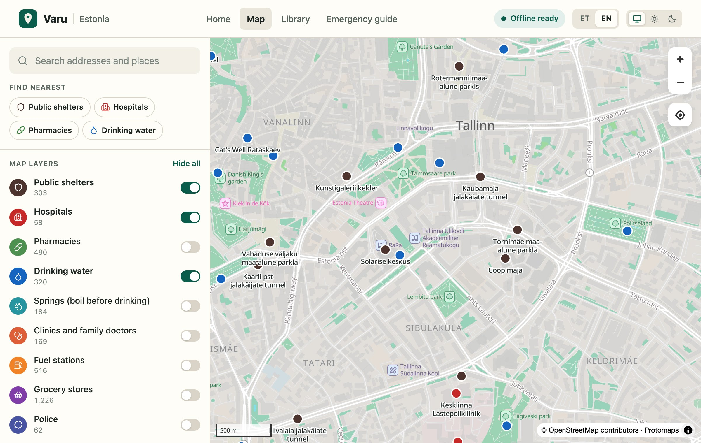
</p>

When the power or the mobile network goes down, the apps you rely on stop
working: online maps, search, the news. **Varu** keeps the essentials on your
own devices, so they work with no internet at all:

- 🗺️ **A map of Estonia**: street level around your home, the whole country for travel.
- 🛡️ **Public shelters**: all 303 of the Rescue Board's shelters, plus hospitals, pharmacies, drinking water, fuel, food stores, police and more.
- 🔎 **Search**: every town, village, street and house address in Estonia.
- 🧭 **Directions**: walking or driving, and "take me to the nearest shelter, by road".
- 📍 **Live directions** on a phone: the next turn, the street name, how far is left.
- 📚 **A library**: Estonian Wikipedia, a medical encyclopedia and a post-disaster handbook collection, searchable.

Varu is free and open source. It doesn't track you, has no ads or accounts,
and needs the internet only once, to download everything.

<table>
  <tr>
    <td align="center" width="33%">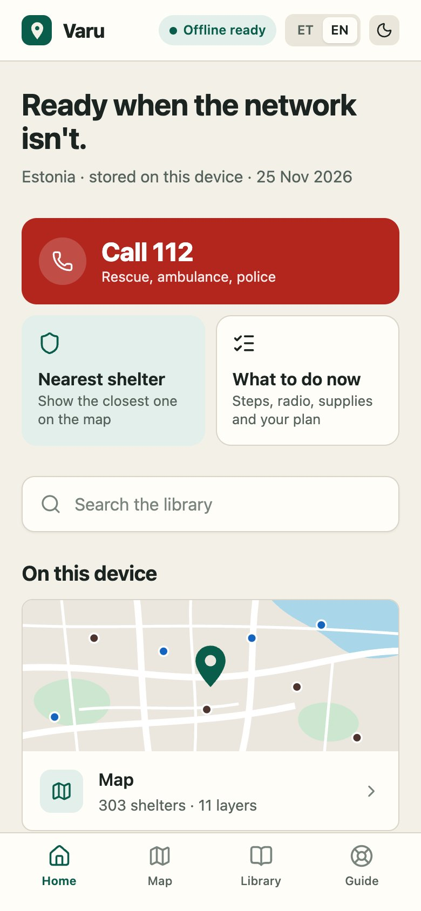<br><sub>The start page</sub></td>
    <td align="center" width="33%">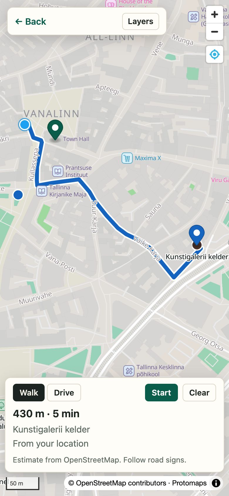<br><sub>Nearest shelter, by road</sub></td>
    <td align="center" width="33%">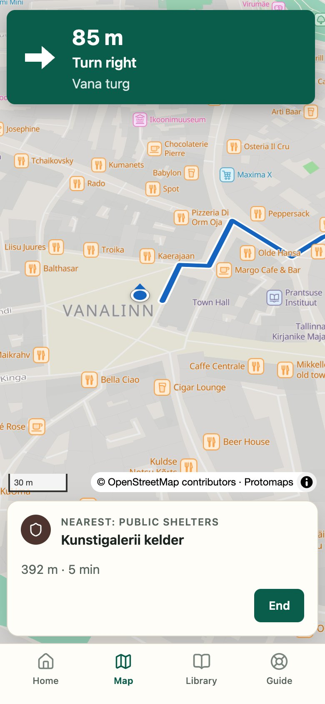<br><sub>Live directions</sub></td>
  </tr>
</table>

---

## Contents

1. [What you need](#-what-you-need)
2. [Install on a computer](#-install-on-a-computer) (Mac, Windows, Linux)
3. [Make a USB stick for your family](#-make-a-usb-stick-for-your-family)
4. [Install on an Android phone](#-install-on-an-android-phone)
5. [Install from the browser](#-install-from-the-browser) (iPhone, iPad, any browser)
6. [Using Varu](#-using-varu): the map, shelters, directions, the library
7. [Opening the stick on another computer](#-opening-the-stick-on-another-computer)
8. [Keeping Varu up to date](#-keeping-varu-up-to-date)
9. [Raspberry Pi](#-raspberry-pi)
10. [In an emergency](#-in-an-emergency)
11. [Questions and problems](#-questions-and-problems)
12. [Where the information comes from](#-where-the-information-comes-from)

---

## ✅ What you need

- **A computer** (Mac, Windows or Linux) or **an Android phone** (Android 7 or newer).
  On an iPhone or iPad, [install from the browser](#-install-from-the-browser).
- **An internet connection, once**, to download Varu. After that, none.
- **For a USB stick:** **16 GB** is a good size. Everything fits on 8 GB, but updating a library book briefly needs room for the old and the new copy.
- **Time:** downloading takes from a few minutes (map only) to an hour or more (all library books on a slow connection).

| What you choose | Download, roughly |
|---|---|
| Map of Estonia and all places | 0.4 GB |
| Varu for Windows, Mac and Linux (put on every stick) | 0.5 GB |
| Estonian Wikipedia (Vikipeedia) | 3.1 GB |
| WikiMed medical encyclopedia (English) | 2.0 GB |
| Post Disaster Resource Library (English) | 0.6 GB |

> 💡 An iPhone can also use the full Varu, library included, over Wi-Fi
> when a computer or Android phone [shares it](#sharing-with-other-phones),
> or from a [Raspberry Pi on your Wi-Fi](#-raspberry-pi).

---

## 💻 Install on a computer

Download the file for your computer from the
**[latest release](https://github.com/renereose/varu/releases/latest)**:

| Your computer | File to download |
|---|---|
| 🍎 **Mac** | [`Varu-macOS.dmg`](https://github.com/renereose/varu/releases/latest/download/Varu-macOS.dmg) |
| 🪟 **Windows** | [`Varu-Setup-Windows.exe`](https://github.com/renereose/varu/releases/latest/download/Varu-Setup-Windows.exe) |
| 🐧 **Linux** | [`Varu-Linux-x86_64.AppImage`](https://github.com/renereose/varu/releases/latest/download/Varu-Linux-x86_64.AppImage), or the `.deb` file from the [release page](https://github.com/renereose/varu/releases/latest) |

<details>
<summary><b>🍎 Mac, step by step</b></summary>

1. Open the downloaded **Varu-macOS.dmg**. A window opens with Varu and an Applications folder.
2. **Drag Varu onto the Applications folder.**
3. Open **Applications** and double-click **Varu**.
4. The first time, your Mac may say *"Apple could not verify Varu…"*. That's
   because Varu is a free project and isn't registered with Apple. To open it anyway:
   - Click **Done**.
   - Open **System Settings → Privacy & Security** and scroll down.
   - Next to *"Varu was blocked…"* click **Open Anyway**, then enter your password.
   - From then on Varu opens normally.
5. Varu starts the setup wizard: continue with
   [Make a USB stick](#-make-a-usb-stick-for-your-family). It's the same
   wizard whether you choose a stick or this computer.

</details>

<details>
<summary><b>🪟 Windows, step by step</b></summary>

1. Open the downloaded **Varu-Setup-Windows.exe**.
2. If Windows says *"Windows protected your PC"*, click **More info**, then
   **Run anyway**. (Varu is a free project without a paid Microsoft certificate.)
3. Varu installs itself and opens the setup wizard: continue with
   [Make a USB stick](#-make-a-usb-stick-for-your-family).

Prefer not to install anything? `Varu-Windows.exe` from the release page runs as is.

</details>

<details>
<summary><b>🐧 Linux, step by step</b></summary>

- **AppImage** (any distribution): right-click the file → **Properties** →
  **Permissions** → tick **Allow executing file as program**, then double-click it.
  In a terminal: `chmod +x Varu-Linux-x86_64.AppImage && ./Varu-Linux-x86_64.AppImage`
- **Debian, Ubuntu, Mint**: download `varu_<version>_amd64.deb` and open it,
  or run `sudo apt install ./varu_*_amd64.deb`. Varu appears in your applications menu.
- For a **Raspberry Pi 4 or 5** with a desktop, use the `arm64` files instead.

</details>

---

## 🔑 Make a USB stick for your family

A Varu stick works on **any** Windows, Mac or Linux computer, without
installing anything. Keep one in the drawer, one in the car, or give one to
your parents.

1. **Plug in the stick.** Everything on it will stay, unless the wizard has
   to reformat it (it always asks first).
2. **Open Varu.** The first time, the wizard starts by itself. Later you'll
   find it under **Go → Install or update…**.
3. Follow the four steps:

<table>
  <tr>
    <td width="50%" valign="top">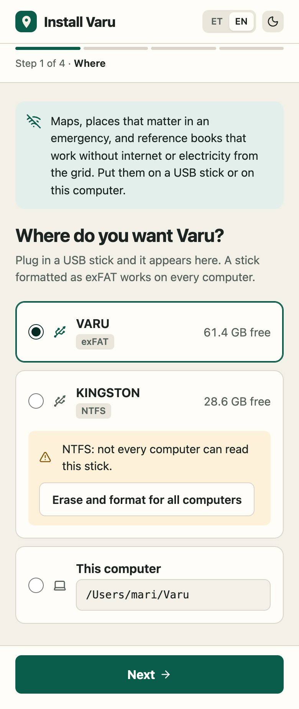<br><b>1. Where Varu goes.</b> Choose your stick. If it isn't in a format every computer can read, Varu offers to erase and format it. It always asks first, because erasing deletes everything on it.</td>
    <td width="50%" valign="top">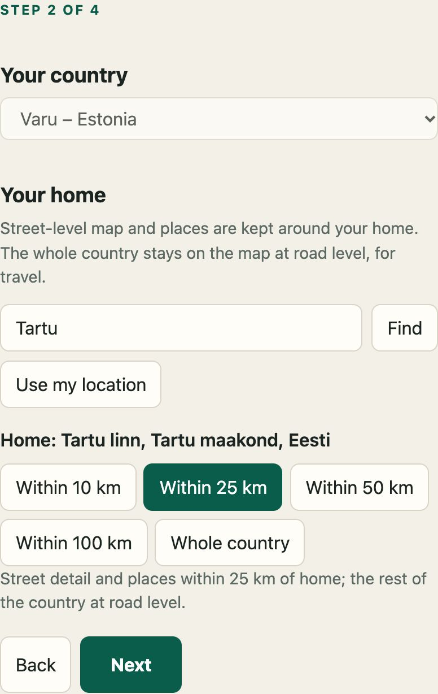<br><b>2. Your home.</b> Type your town or village and press <b>Find</b>. Then choose how far around it you want street-level detail: 10, 25, 50 or 100 km, or the whole country.</td>
  </tr>
  <tr>
    <td valign="top">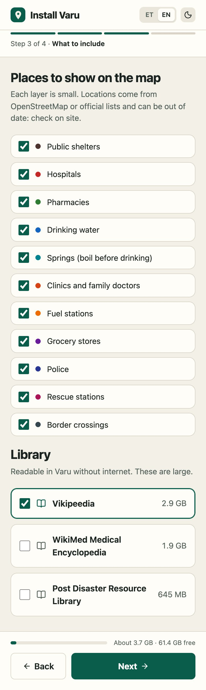<br><b>3. Places and books.</b> All places are ticked: they're small. Tick the library books you want; each one is large.</td>
    <td valign="top">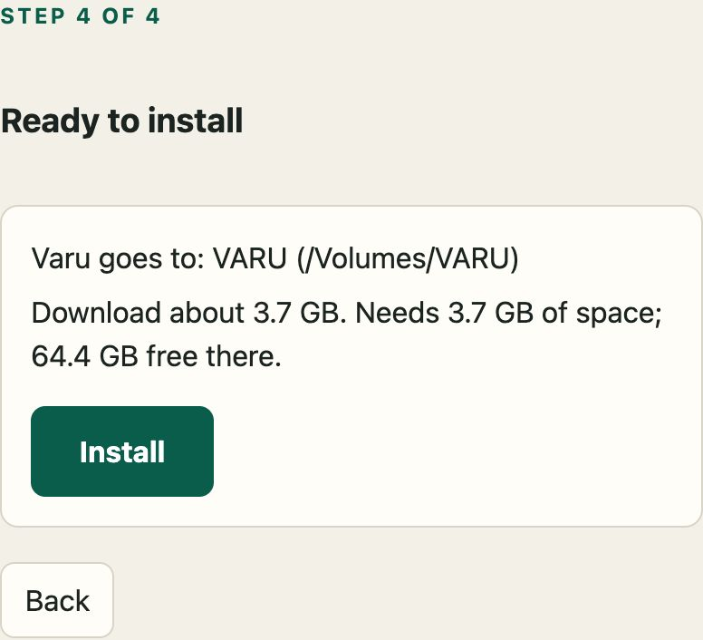<br><b>4. Review.</b> Check the download size and the free space, then press <b>Install</b>.</td>
  </tr>
</table>

4. **Wait for "Varu is ready".** If the connection breaks, open Varu again:
   it continues where it stopped.
5. **Eject the stick** before unplugging it: on a Mac, the ⏏ button in
   Finder; on Windows, *Safely Remove Hardware*.

When you open the stick, you'll see only four files: one Varu for each
system, and a README. The maps and books are there too, just hidden so
nobody deletes them by accident.

---

## 📱 Install on an Android phone

1. On the phone, open this page and download
   **[Varu.apk](https://github.com/renereose/varu/releases/latest/download/Varu.apk)**.
2. Open the downloaded file. Android will ask for permission to install apps
   from your browser: tap **Settings**, turn on **Allow from this source**,
   go back and tap **Install**.
3. If *Play Protect* warns about an unknown app, tap **More details →
   Install anyway**. Varu isn't in the Play Store yet.
4. Open **Varu**. The same setup wizard starts. Choose **This phone** (or
   the memory card, if your phone has one), your home and what you want, then **Install**.
5. Stay on Wi-Fi while it downloads. Varu asks to show notifications: allow
   it to see the progress there. You can lock the phone or use other apps
   meanwhile; the download carries on. Afterwards Varu works in flight mode too.

To change or update what's on the phone later, tap **Update maps and data** on the start page.

---

## 🌐 Install from the browser

For iPhones and iPads, which have no App Store app, and for anyone who'd
rather not install anything. Varu runs in the browser and keeps its data there.

1. Open **[renereose.github.io/varu](https://renereose.github.io/varu/)**.
   - **iPhone or iPad:** in Safari, first tap **Share → Add to Home Screen**,
     then open Varu from the Home Screen and continue there. Safari keeps a
     Home Screen app's storage separate from the browser's.
   - **Chrome or Edge** (computer or Android): continue on the page.
     **Install as an app** adds an icon.
2. Choose what to include. **The app and the emergency guide** (about 26 MB)
   is always there; the street map, address search and directions add up to
   about 0.4 GB in all.
3. Tap **Install** and stay on Wi-Fi. The page shows the speed and the time left.
4. Tap **Open Varu**. From then on it works with no internet.

When you open Varu while online, it checks for updates: small ones download
by themselves, bigger ones ask first.

The web app has the map, search, directions and the emergency guide, but not
the library, and it can't share Varu with other phones. It's new and not yet
tested on a real iPhone.

---

## 🧭 Using Varu

### The start page

Varu opens to its start page. On a computer the bar at the top leads to the
**Map**, the **Library** and the **Emergency guide**; on a phone they are tabs
at the bottom. The **In an emergency** panel has **Call 112**, **Nearest
shelter** (the map, with the route to the closest public shelter) and **What
to do now** (the emergency guide). Below: what is on this device, and the date
of the map data, so you know how fresh it is. The search box looks through
every book in the library.

Next to the language switch, the theme switch picks light, dark or the
device's own setting. Varu remembers both on that device.

### The emergency guide

The **Emergency guide** has four sections. On a computer the situations are
listed down the side and the one you pick opens beside them; on a phone they
are cards, with 112 in a red banner on top.

- **When it happens**: short steps for a power cut, no tap water, no heating,
  phone and internet down, a siren or public warning, taking shelter,
  evacuation, fire, carbon monoxide, storm, flood, getting lost in the woods
  and calling 112. Each card links to the nearest place on the map and to
  articles in the library, and names the official source it is based on
  (kriis.ee, the Rescue Board, the Ministry of the Interior, the Health Board
  and the Emergency Response Centre).
- **Radio**: where to tune a battery or car radio when power or phones are
  down. Vikerraadio (in Estonian) and Raadio 4 (in Russian), with each
  transmitter's frequency from ERR's own list. It is printed with your plan.
- **Home supplies**: a checklist for managing a week on your own. Ticks are
  kept on that device.
- **My plan**: contacts, meeting places, where documents and medicines are.
  Kept only on that device: press **Print my plan** and keep a paper copy as
  well. The printout has the radio frequencies and the supplies list too.

### The map

<p align="center"></p>

- **Map layers** (down the side on a computer, at the bottom on a phone) lists
  what the map can show: shelters, hospitals, water and more. Switch one on to
  show it, and tap a dot for its name and address.
- **Find nearest** (under the search box) finds the closest shelter, hospital,
  water or pharmacy **by road**, not in a straight line, so a river or the sea
  doesn't send you the long way round. A layer you switch on gets a button
  there too.
- The **◎ button** (on the right) shows where you are. Phones use GPS, which
  works without internet. Most computers have no GPS.

### Search

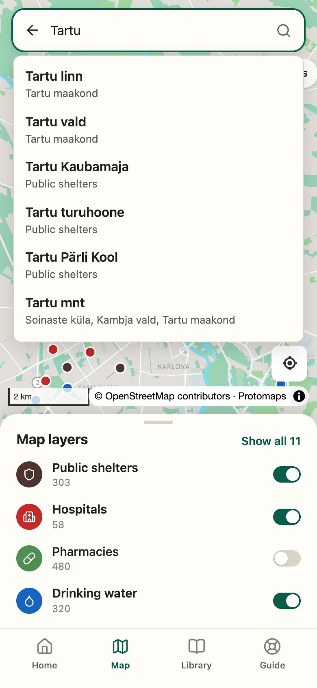

Type in the box above the layers: a town or village (**Otepää**), a street,
a house address (**Rüütli 12 Pärnu**), or a place from the map layers, such as
a hospital or shelter (**Tartu Ülikooli Kliinikum**).

- Letters like õ, ä, ö and ü can be typed without their marks: **otepaa** finds Otepää.
- Tap a result and the map goes there. Its pin offers **Route here** and **Start here**.
- Every address in Estonia is on the drive, even outside your home area.

<br clear="right">

### Directions

- **On a phone:** press and hold a spot on the map. **On a computer:** right-click it.
  Then choose **Route here**, or **Start here** to begin somewhere else.
- Choose **Walk** or **Drive**. The panel shows the distance and time.
- **Start** begins **live directions**: the next turn and its street are
  shown at the top, the map turns with you, and if you take a wrong turn
  Varu finds a new route. **End** stops it.

<table>
  <tr>
    <td align="center" width="50%"><br><sub><b>Find nearest</b> shelter: 392 m, 5 minutes on foot</sub></td>
    <td align="center" width="50%"><br><sub><b>Start</b>: "85 m, turn right, Vana turg"</sub></td>
  </tr>
</table>

> ⚠️ Directions are an estimate from OpenStreetMap. Varu doesn't know about
> closed roads or traffic. Always follow road signs and the authorities.

### The library

<table>
  <tr>
    <td align="center" width="50%">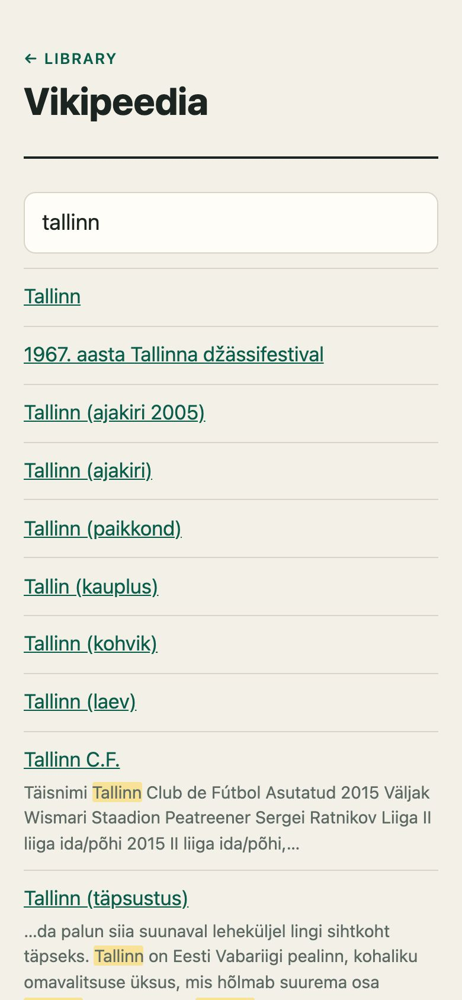<br><sub>Opening Vikipeedia: search it straight away</sub></td>
    <td align="center" width="50%">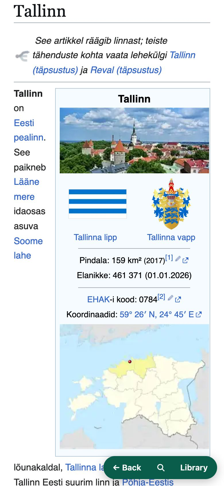<br><sub>Reading Vikipeedia: <b>← Back</b>, <b>🔍 Search</b>, <b>Library</b></sub></td>
  </tr>
</table>

- The **Library** page searches every book at once; **All books** (on a phone,
  the buttons under the box) narrows it to one. Matching **titles** come first,
  then **articles that mention your words**, with the words in bold.
- **Books on this device**, beside the results, opens a book's front page.
- Inside a book, the green bar at the bottom has **Back**, **🔍 Search** (search
  that book) and **Library**.
- **Survival and DIY** on the Library page lists hand-picked articles by topic:
  first aid, water, food, heat and fire, shelter, power and light,
  communication, hygiene, tools and repair, navigation, hazards and civil
  protection. When you search, matching ones come first, marked ★.
- Longer words also find their other forms: *tallinn* finds *Tallinnas*.

### Sharing with other phones

A computer or Android phone running Varu can share it with every phone,
tablet and laptop on the same Wi-Fi, iPhones too, and none of them needs
the internet or an app.

1. At the bottom of the start page, open **Share with other devices** and
   press **Turn sharing on**. A computer may ask whether Varu may accept
   network connections: allow it.
2. On the other phone, join the same Wi-Fi (or this computer's or phone's
   hotspot), then scan the code with the camera or type the address shown.
3. **Stop sharing**, or closing Varu, ends it.

On the other devices the map, places, **Find nearest**, directions and the library
all work. **Show my location** and **live directions** don't: browsers only
share your location with apps on the device itself or with secure (https)
sites. On the map, press and hold → **Start here** to say where you are.

---

## 🔌 Opening the stick on another computer

| Computer | What to do |
|---|---|
| 🪟 Windows | Open the stick and double-click **Varu-Windows.exe**. If *"Windows protected your PC"* appears: **More info → Run anyway**. |
| 🍎 Mac | Open the stick, double-click **Varu-macOS.dmg**, then double-click **Varu** in the window that opens. No need to install it. |
| 🐧 Linux | Double-click **Varu-Linux-x86_64.AppImage**. On Ubuntu and Fedora, Varu may offer to start as soon as you plug the stick in. |

Varu finds its maps and books on the stick by itself. Nothing is installed or
left behind on the computer.

---

## 🔄 Keeping Varu up to date

New versions bring new features, fresh maps and newer books. To update:

1. Download and install the new version of the app, as above.
2. Open Varu. If your maps and data are older than the app, Varu asks
   **"Update the maps and data?"** Tap **Update**, or **Later**: Varu keeps
   working meanwhile, also offline.
3. The wizard opens on its last step with your earlier choices. Press **Install**.
   Files that haven't changed aren't downloaded again. When a book has a newer
   edition, the old one is deleted once the new one has fully downloaded, so old
   copies don't take up space.

To update a stick, plug it in and choose **Go → Install or update…**. On a
phone, tap **Update maps and data** on the start page.

> 💡 Update your stick every few months: shops close, roads change, and
> new shelters are added.

---

## 🍓 Raspberry Pi

### A Varu box for your home Wi-Fi

A small Raspberry Pi can run Varu all the time and share it with every phone,
tablet and laptop on your Wi-Fi, iPhones included. With a power bank it keeps
going during a power cut.

> 🧪 This works with the files Varu already ships, but hasn't been tried on a
> real Raspberry Pi yet. If you try it, please tell us how it went.

**You'll need:**
- A **Raspberry Pi Zero 2 W**, 3, 4 or 5. The original Pi Zero and Zero W
  are too old for Varu.
- A **microSD card** (16 GB+), the Pi's power supply or a power bank.
- A **Varu USB stick** made with the wizard, and for the Zero 2 W a
  **micro-USB to USB-A adapter** (OTG).

**Setting it up:**

1. On your computer, install **[Raspberry Pi Imager](https://www.raspberrypi.com/software/)**.
   Choose your Pi, then **Raspberry Pi OS Lite (64-bit)**, then your card.
   When asked, **edit the settings**: choose a user name and password, enter
   your Wi-Fi and turn on **SSH**.
2. Put the card in the Pi, plug in the Varu stick (on the Zero 2 W, use the
   port marked **USB**, not PWR) and connect the power. Wait two minutes.
3. On your computer, open **Terminal** (Mac, Linux) or **PowerShell**
   (Windows) and connect, using the name and user you chose:
   ```sh
   ssh mari@raspberrypi.local
   ```
4. Make the stick open at the same place on every start:
   ```sh
   sudo mkdir -p /mnt/varu
   echo "LABEL=VARU /mnt/varu exfat defaults,nofail,uid=$(id -u),gid=$(id -g) 0 0" | sudo tee -a /etc/fstab
   sudo systemctl daemon-reload && sudo mount -a && ls /mnt/varu
   ```
   You should see `Varu-Windows.exe` and the other files. If not, run
   `lsblk -f` and use your stick's name instead of `VARU` (Varu names the
   sticks it formats `VARU`).
5. Start Varu every time the Pi starts:
   ```sh
   sudo tee /etc/systemd/system/varu.service >/dev/null <<EOF
   [Unit]
   Description=Varu
   RequiresMountsFor=/mnt/varu
   Wants=network-online.target
   After=network-online.target
   [Service]
   User=$USER
   ExecStart=/mnt/varu/bin/linux-arm64/varu -root /mnt/varu -lan -no-browser
   Restart=on-failure
   [Install]
   WantedBy=multi-user.target
   EOF
   sudo systemctl enable --now varu
   journalctl -u varu -n 20
   ```
   The last command shows an address such as `Network: http://192.168.1.23:8480/`.
6. **On any phone or laptop on the same Wi-Fi, open that address.** Add it to
   your home screen to find it again easily.

**No router?** The Pi can make its own Wi-Fi network, called *Varu*:
```sh
sudo nmcli device wifi hotspot ssid Varu password "choose-a-password"
sudo nmcli connection modify Hotspot connection.autoconnect yes
```
Join the *Varu* network and open `http://10.42.0.1:8480/`.

> ℹ️ Shared over Wi-Fi, the map, places, **Find nearest**, directions and the
> library all work. **Show my location** and **live directions** don't:
> browsers only share your location with apps on the device itself or with
> secure (https) sites. On the map, press and hold → **Start here** to say where you are.

**A Pi 4 or 5 with a screen, keyboard and mouse:** install *Raspberry Pi OS
(64-bit)* with the desktop, then the Linux `arm64` Varu
(`varu_<version>_arm64.deb`) from the release page, and use it like on any computer.

### Planned: a pocket device

A pocket-sized Varu with an e-ink screen and GPS is planned. It doesn't work
yet; this section will grow when it does.

---

## 🆘 In an emergency

- **In danger, call 112.** Varu is a reserve, not a rescue service.
- Phones find their position by **GPS without internet or mobile network**.
  Charge your phone and a power bank in good time, and keep the phone on
  low power mode.
- Varu's information is a **snapshot**: the start page shows its date.
  Places may have closed or moved. Check on site.
- **Follow the authorities.** When they can be reached, their instructions
  come first: on the radio (ERR), and at [kriis.ee](https://www.kriis.ee)
  when the internet works.
- Put a stick where the whole family knows to look, and tell them how to
  open it ([see above](#-opening-the-stick-on-another-computer)).

---

## ❓ Questions and problems

<details>
<summary><b>My Mac says Varu can't be opened.</b></summary>

Varu isn't registered with Apple. Open **System Settings → Privacy &
Security**, scroll down and click **Open Anyway** next to Varu. You only need
to do this once. When you open Varu from a stick, this usually doesn't appear.

</details>

<details>
<summary><b>Windows says "Windows protected your PC".</b></summary>

Click **More info**, then **Run anyway**. Windows shows this for programs
without a paid certificate.

</details>

<details>
<summary><b>The stick shows only four files. Where are the maps?</b></summary>

They're there, but hidden on purpose, so nobody deletes them by accident.
Don't delete hidden files from the stick. To see them anyway: on a Mac press
<kbd>⌘</kbd><kbd>⇧</kbd><kbd>.</kbd> in Finder; on Windows choose
**View → Show → Hidden items**.

</details>

<details>
<summary><b>"Not enough space".</b></summary>

Choose fewer library books or a smaller area around your home, or use a
bigger stick. If the stick holds other files, the wizard can erase it for
you, after asking.

</details>

<details>
<summary><b>"Show my location" doesn't work on my computer.</b></summary>

Most computers have no GPS. Use Varu on a phone, or on the map
right-click → **Start here** to say where you are.

</details>

<details>
<summary><b>Map search, live directions or library search are missing after updating the phone app.</b></summary>

These live in the downloaded data, not in the app. Open Varu and choose
**Update** when asked, or tap **Update maps and data** → **Install**.

</details>

<details>
<summary><b>The phone says "App not installed" when updating.</b></summary>

Download `Varu.apk` only from this project's
[releases page](https://github.com/renereose/varu/releases). A copy from
anywhere else can't replace the app.

</details>

---

## 📖 Where the information comes from

| What | From | Licence |
|---|---|---|
| Map, places, roads | © [OpenStreetMap](https://www.openstreetmap.org/copyright) contributors, basemap by [Protomaps](https://protomaps.com) | ODbL |
| Public shelters | Päästeamet (Estonian Rescue Board), via Maa- ja Ruumiamet | Land Board open data |
| Addresses, streets, towns | Maa- ja Ruumiamet (Land and Spatial Development Board), [address data system](https://geoportaal.maaamet.ee/eng/spatial-data/address-data-p313.html) | open data |
| Vikipeedia, WikiMed | Wikipedia, packaged by [Kiwix](https://kiwix.org) | CC BY-SA |
| Post Disaster Resource Library | [Kiwix](https://library.kiwix.org) | each document's own |
| Varu itself | this repository | [MIT](LICENSE) |

Place data is kept up by volunteers and can be wrong or incomplete. If
something on the map is missing or wrong, you can fix it for everyone at
[openstreetmap.org](https://www.openstreetmap.org).

---

<p align="center">
  <b>For developers:</b> how Varu is built, tested and released is in
  <a href="docs/DEVELOPMENT.md">docs/DEVELOPMENT.md</a>, and what's next in
  <a href="docs/ROADMAP.md">docs/ROADMAP.md</a>.
</p>
